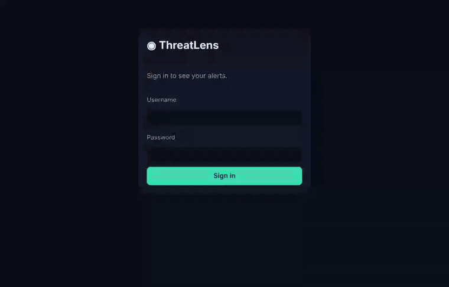
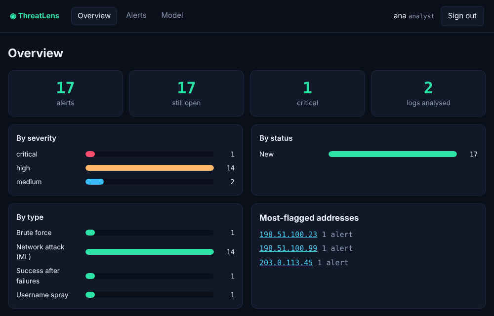
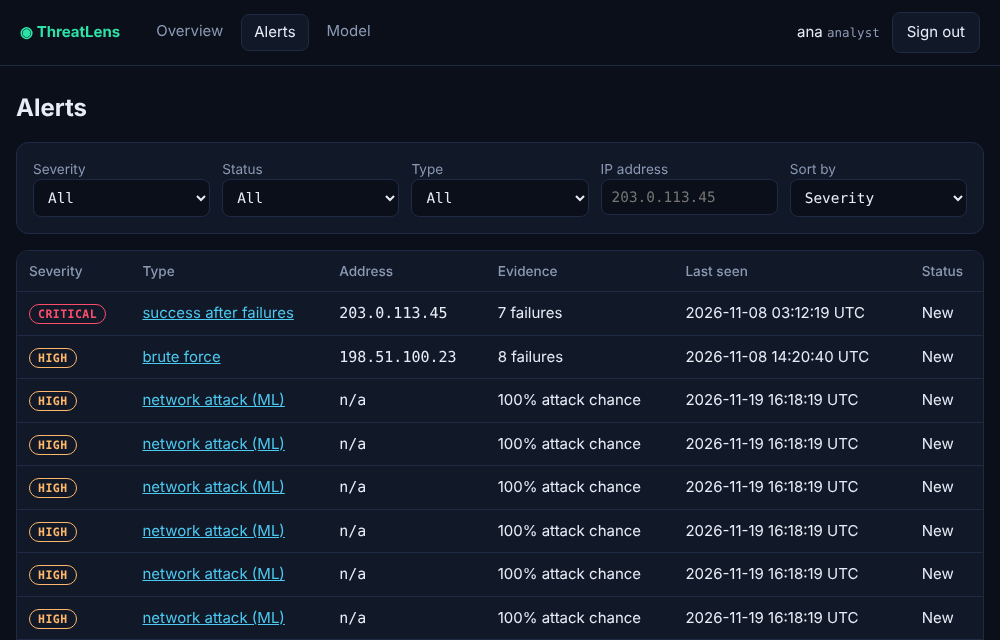
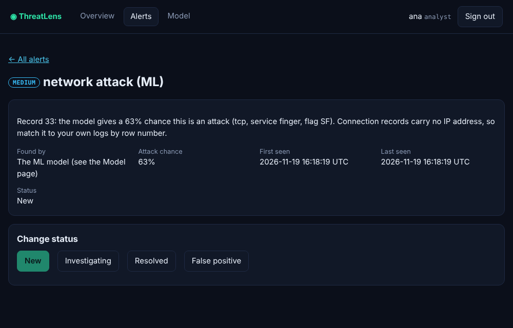
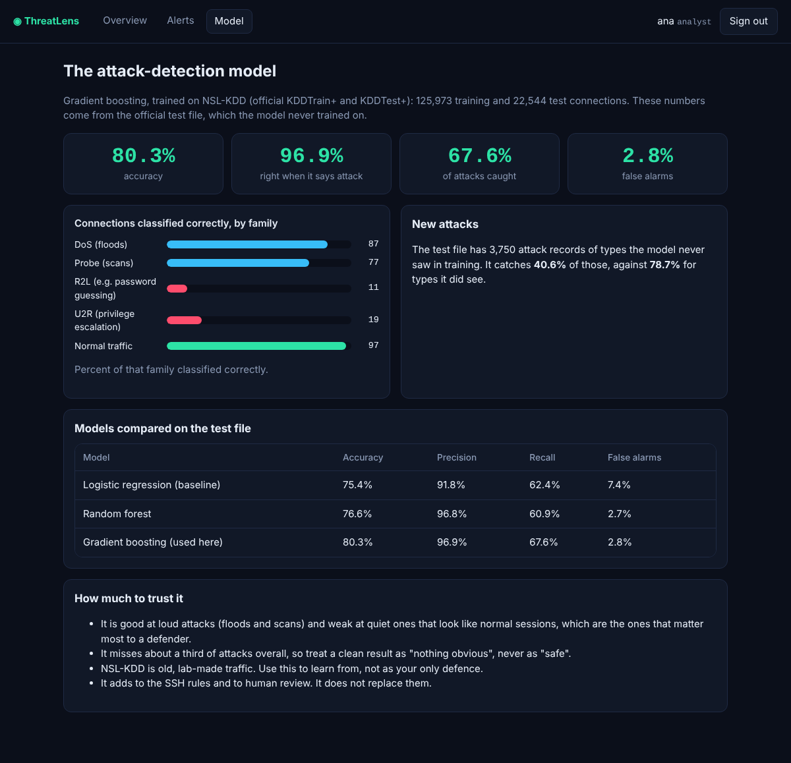

# ThreatLens

A small security monitoring platform (a mini SIEM). Upload SSH logs or network connection records, get ranked alerts from detection rules and a machine-learning model, and work through them in a dashboard. Built by [Beamlak](https://github.com/lasmeldas).




| | |
| --- | --- |
|  |  |
|  |  |

## What it does

- **Rule detection on SSH logs.** Ranks source IPs: **critical** (a login succeeded right after a burst of failures), **high** (a brute-force burst), **medium** (slow username spraying). The rules come from my tool [authwatch](https://github.com/lasmeldas/authwatch).
- **ML detection on network connections.** A gradient-boosting model trained on the public NSL-KDD benchmark scores connection records and raises alerts for likely attacks. [Full evaluation](ml/README.md).
- **An analyst workflow.** Filter and sort alerts, open one, set its status (`new`, `investigating`, `resolved`, `false_positive`). Every upload and status change goes in an audit log.
- **Roles.** Viewers can read, analysts can also upload and change status, admins can also read the audit log. Enforced on the server.

### How good is the ML, honestly?

On the official NSL-KDD test file: **80.3% accuracy, 96.9% precision, 67.6% recall, 2.8% false alarms**. It is strong on floods and scans (DoS 87%, Probe 77%) and weak on quiet attacks (R2L 11%, U2R 19%), and it catches 41% of attack types it never saw in training. So it misses about a third of attacks and **adds to the rules, it does not replace them**. The dashboard's Model page shows all of this, and the [ML write-up](ml/README.md) explains the method, including a change I made to the model-selection rule after a first run.

## Try it in two minutes

You need Docker. This starts the dashboard, the API and PostgreSQL:

```bash
cp .env.example .env            # then edit it: set DJANGO_SECRET_KEY and DB_PASSWORD
docker compose up --build       # dashboard at http://localhost:8080

# in another terminal: create an analyst, then load the sample data
docker compose exec -e THREATLENS_PASSWORD='choose-a-long-passphrase' api python manage.py create_user ana --role analyst
docker compose exec api python manage.py seed_demo --user ana
```

Sign in as `ana` at http://localhost:8080. The seed command loads a sample SSH log (3 alerts) and 60 real NSL-KDD connections (14 alerts). You can also upload your own on the Overview page.

I have not hosted a public demo: the API needs a server and a database, and I did not want to leave a security tool running on the open internet without HTTPS and monitoring. The GIF above is a real recording of the app running locally.

<details>
<summary>Run without Docker</summary>

```bash
cd backend
python -m venv .venv && source .venv/bin/activate
pip install -r requirements.txt
export DJANGO_DEBUG=1                  # local development only
python manage.py migrate
THREATLENS_PASSWORD='a-long-passphrase-here' python manage.py create_user ana --role analyst
python manage.py seed_demo --user ana
python manage.py runserver             # API on :8000

# second terminal
cd frontend && npm install && npm run dev      # dashboard on :5173
```
</details>

## API

| Method and path | Who | Purpose |
| --- | --- | --- |
| `POST /api/auth/token/` | anyone (rate limited) | username and password in, token and role out |
| `POST /api/auth/logout/` | signed in | revoke the current token |
| `GET /api/me/` | signed in | who am I and what is my role |
| `POST /api/uploads/` | analyst | analyse an SSH log (`log` text or `file`, plus `year`, `threshold`, `window`, `spray_users`) |
| `POST /api/connections/` | analyst | score NSL-KDD style connection records (`csv` text or `file`, plus `threshold`, `max_alerts`) |
| `GET /api/uploads/`, `/api/uploads/<id>/` | signed in | past uploads |
| `GET /api/alerts/` | signed in | filter by `severity`, `status`, `kind`, `source`, `ip`, `upload`; `ordering=newest\|severity\|failures` |
| `GET /api/alerts/<id>/` | signed in | one alert |
| `PATCH /api/alerts/<id>/` | analyst | change `status` (nothing else can be changed) |
| `GET /api/stats/` | signed in | counts by severity, status, type and source; top addresses |
| `GET /api/ml/model/` | signed in | what the model was trained on and how it scored |
| `GET /api/audit/` | admin | who did what |

## Design and security

- [Architecture](docs/architecture.md): the pieces, the data flow, and the decisions behind them.
- [Threat model](docs/threat-model.md): ten threats, what the code does about each, and what is **still open** (for example, there is no HTTPS in the Compose file, so put it behind a TLS proxy before any real use).

## Tests

| Part | Command | Tests |
| --- | --- | --- |
| API | `cd backend && DJANGO_DEBUG=1 python manage.py test` | 52 |
| Dashboard | `cd frontend && npm test` | 25 |
| ML | `cd ml && python -m pytest tests` | 7 |

Highlights: the SSH rules are checked against **28 logs whose alerts were produced by the real authwatch**; the backend's feature list is checked against the training code's; one ML test downloads the official test file and re-checks the published numbers; the dashboard is tested for roles, errors, filters and uploads. CI runs all of it, on Python 3.11 to 3.13 with SQLite, on PostgreSQL 16, and on Node 22. I also ran the whole app in a real browser, on desktop and phone width.

## Project layout

```
backend/    Django REST API, detection rules, scoring, tests
frontend/   React dashboard, nginx config, tests
ml/         NSL-KDD training code, trained model, evaluation, tests
docs/       architecture, threat model, screenshots
```

## License

MIT
