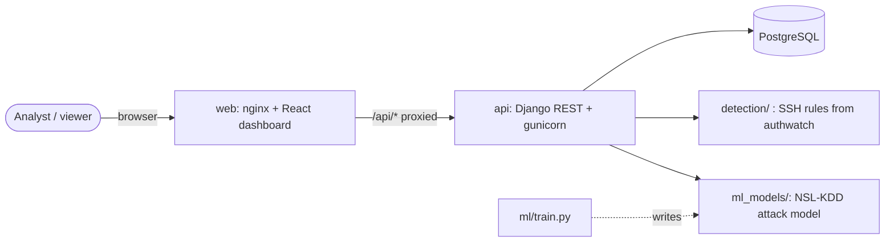

# Architecture

## Pieces

| Piece | Where | Job |
| --- | --- | --- |
| Dashboard | `frontend/` | React (Vite). Talks only to `/api`. Keeps the login token in `sessionStorage`. |
| API | `backend/alerts/` | Authentication, roles, uploads, alerts, stats, audit log, rate limiting. |
| Rules | `backend/detection/` | Parses OpenSSH auth logs and ranks source IPs (critical, high, medium). A copy of the [authwatch](https://github.com/lasmeldas/authwatch) engine, checked against it by a parity test. |
| Model | `ml/` and `backend/alerts/scoring.py` | A gradient-boosting classifier trained on NSL-KDD. `scoring.py` validates records and loads the saved model once. |
| Database | PostgreSQL (SQLite for local runs and tests) | Uploads, alerts and the audit log. |

## Data flow

**SSH log.** An analyst uploads text or a file. `services.analyze_ssh_log` parses it, runs the rules, and stores one `Upload` plus an `Alert` per flagged address, all in one transaction with an audit entry.

**Network connections.** An analyst uploads CSV records. `scoring.parse_records` checks that every row has 41 values (or 43 with the label columns) and that numeric columns really are numbers, naming the row and column if not. The model scores each row; records at or above the threshold become alerts, highest score first, capped at `max_alerts`. These alerts have a score and no address, because the dataset has none.

**Working an alert.** The only thing that can change on an alert is its `status`. Each change is written to the audit log with the old and new value.

## Decisions worth knowing

- **Rules and ML are separate on purpose.** Rules explain themselves ("5 failures in 300 seconds, then a success"). The model adds coverage but cannot explain individual calls, and it is weak on quiet attacks, so it never raises a *critical* alert.
- **One shared service layer.** The API views and the `seed_demo` command call the same functions in `alerts/services.py`, so the demo data goes through exactly the same code as a real upload.
- **The model is part of the build.** The Docker image copies `ml/models/` in, and a test checks that the backend's feature list is identical to the training code's.
- **Static model, no learning from feedback yet.** Marking an alert as a false positive is recorded but does not retrain anything.
